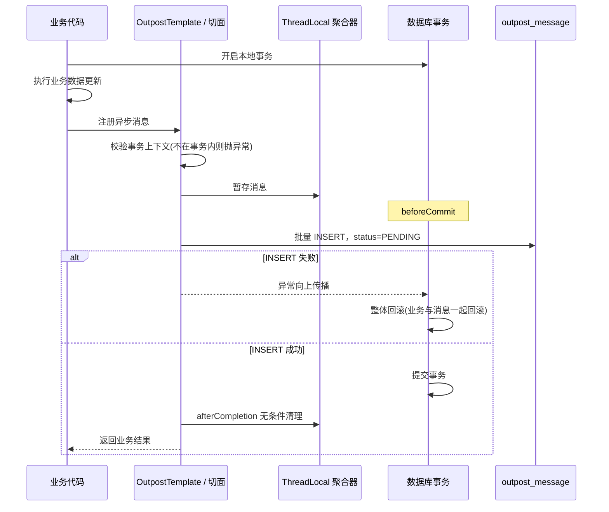
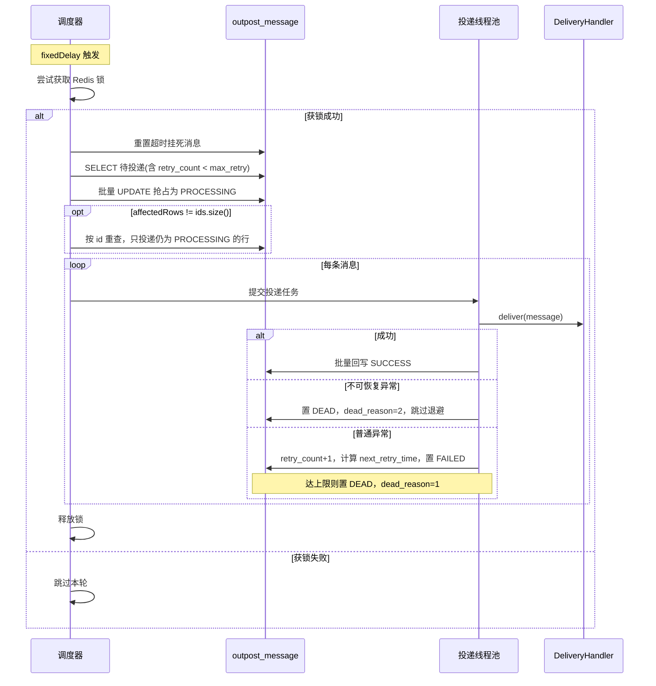

# Outpost 通用本地消息表 SDK V1.0 详细设计文档（终版）

| 文档版本 | V1.0 终版 | 编写日期 | 2026-11-12 |
| --- | --- | --- | --- |
| 文档状态 | 已评审，可进入开发 | 定位 | 通用型嵌入式本地消息表（Outbox Pattern）SDK |

> 本版为七轮设计评审后的修订终版。相对初稿，核心变化为：删除幂等表、生产路径定位修正为「主链路」、调度改为批量抢占、新增延迟双删与辅助消息、SPI 契约收紧为纯字符串 payload + 只读 DTO、补齐迁移灰度与回滚方案、模块从 7 个收缩到 2 个发布模块。全部决策见 §1.7。

## 1. 文档概述

### 1.1 产品定位

**Outpost** 是一款轻量级、无独立服务端、嵌入式的通用本地消息表 SDK，基于 Outbox Pattern 实现，核心价值是**保证「业务数据库事务提交成功」与「下游异步动作最终执行」之间的最终一致性**。

需要先讲清楚它**不是**什么：它不是「缓存一致性解决方案」，而是「可靠异步投递底座」。二者差一层——底座保证「删除动作一定会被执行」，不保证「缓存永远等于数据库」。后者需要叠加延迟双删、TTL 兜底等场景层机制，本 SDK 只提供其中可工程化的那一部分，并在 §7.5 明确声明剩余边界。

### 1.2 设计目标

1. **可靠不丢**：DB 事务提交成功，异步动作最终必然执行至少一次；执行结果可观测。
2. **定位诚实**：生产路径（事务内写消息）是业务主链路的一部分，DB 故障时与业务数据一同回滚，不做异常吞噬；投递路径（调度、执行）才做故障隔离。
3. **内核插件化**：投递处理器、调度引擎、死信监听器均为 SPI，新增场景不改内核。
4. **场景开箱即用**：内置缓存失效场景封装（注解一行接入）与延迟双删优化。
5. **极简可维护**：不做通用幂等表、不扩展状态机、不做链式处理器、不做内建序列化。所有被砍掉的能力都必须先证明「它的收益 > 它带来的长期维护成本」。
6. **可观测可运维**：核心指标、标准化日志、死信治理、消息清理。

### 1.3 能力边界

**V1.0 明确支持：**

| 能力 | 说明 |
| --- | --- |
| 同库同事务原子写入 | 消息表与业务表位于同一物理库、同一 `DataSource` bean 实例 |
| 单级集中式 Redis 缓存失效 | `DEL` 与 Rockscache `TagAsDeleted` 两种处理器 |
| 延迟双删 | 事务提交后删一次 + 延迟再删一次，降低并发回填脏数据概率 |
| 至少一次投递 + 指数退避 | 默认 10 次，退避阶梯 1s→3s→10s→30s→60s→300s |
| 死信治理 | 分原因告警、运维重发、到期自动清理 |
| 多实例部署 | Redis 全局锁模式，单实例调度 + 其余主备 |

**V1.0 明确不支持（写入文档，避免误用）：**

| 不支持的能力 | 原因 | 兜底建议 |
| --- | --- | --- |
| 强一致性 | 异步模型决定 | 需要强一致请同步删 + 分布式锁 |
| Cache-Aside 读写并发脏回填的彻底消除 | 一次性删除无法防御「删除之后到达的写回」 | 延迟双删降低概率 + 缓存 key 必须设 TTL |
| 本地缓存（Caffeine/Guava）失效 | 无统一入口，跨实例无法触达 | 业务基于 SPI 自建 MQ 广播处理器 |
| 跨库 / 跨数据源事务 | 物理上不可实现 | 业务保证消息表与业务表同库同数据源 |
| 水平扩容（V1.0） | 全局 Redis 锁，多实例恒为主备 | 吞吐不足请等待 V1.1 的 SKIP LOCKED |
| 消息顺序性 | 多线程 + 多实例并发投递 | 需要顺序请自行按 bizKey 分片串行 |
| 通用业务级幂等 | 不同场景幂等语义差异巨大 | 由 handler 自行实现，见 §5.4 |

### 1.4 适用场景

| 场景分类 | 说明 | 支持版本 |
| --- | --- | --- |
| DB + Redis 缓存失效 | DB 更新后可靠删除/标记缓存，解决缓存永久脏数据 | V1.0 内置 |
| 可靠 MQ 消息投递 | 替代事务消息，保证 DB 落库则消息一定发出 | V1.1 |
| 领域事件发布 | 业务落库后可靠发布领域事件 | V1.2 |
| 可靠 HTTP/RPC 回调 | 保证业务成功后触发下游接口调用 | V1.2 |
| 跨库数据同步 | 业务库变更后触发数据同步 | 待评估（受同库约束限制） |

**V1.0 的目标不是覆盖上表全部**，而是替换单业务线自研的 `cache_key_queue`，验证「用一张 DB 表换可靠性」这笔交易划不划算。

### 1.5 读者对象

后端开发工程师、基础架构工程师、测试工程师、运维工程师。

### 1.6 术语定义

| 术语 | 说明 |
| --- | --- |
| Outbox Pattern | 在同一个数据库事务中把业务变更与待投递消息一起落库，保证原子性 |
| 生产路径 | 业务事务内写入消息的过程，属于主链路 |
| 投递路径 | 调度、抢占、执行 handler 的过程，与业务线程隔离 |
| 批量抢占 | 一次 UPDATE 把一批待投递消息置为 PROCESSING，替代逐条 CAS |
| 辅助消息 | 延迟双删中的第二次删除，失败可忽略，不参与死信治理 |
| 不可恢复异常 | handler 明确告知「重试永远不可能成功」的异常，直接进死信 |
| namespace | 缓存消息的业务域标识，用于灰度与统计，粒度为业务模块 |

### 1.7 关键设计决策记录（ADR 摘要）

| 编号 | 决策 | 结论 | 理由 |
| --- | --- | --- | --- |
| D01 | 是否保留幂等表 | **删除** | `bizType+bizKey` 作为幂等键会把「同一业务键的第二次有效变更」误判为重复，导致漏删缓存；改用 messageId 则与状态机重叠，收益极低 |
| D02 | 重复投递如何兜底 | handler 必须天然幂等 | 幂等是业务语义，内核不提供通用屏障 |
| D03 | 超时重置与批量抢占 | 扫表增加 `retry_count < max_retry` | 避免 FAILED 既是「待重试」又需表达「终态」的矛盾 |
| D04 | 持锁路径抢占方式 | 批量 UPDATE | 全局锁下无并发竞争，逐条 CAS 是纯开销 |
| D05 | 生产路径失败语义 | 与业务同事务回滚 | 同库同事务下「消息失败、业务成功」物理上不存在 |
| D06 | payload 契约 | 纯字符串，内核不序列化 | 避免绑定 JSON 库与承担 schema 演进责任 |
| D07 | SPI 入参 | 只读 DTO `OutboxDeliveryMessage` | 隔离表结构，避免后续加列成为 breaking change |
| D08 | 持久层 | 仅 `JdbcTemplate` | 无 ORM、无 javax/jakarta 迁移、SQL 可控 |
| D09 | 缓存失效默认处理器 | `delete` | rockscache_tag 要求读路径改造，接入门槛高 |
| D10 | 延迟双删 | V1.0 默认开启 | 已有延迟消息基建，ROI 极高 |
| D11 | 状态机 | 保持 5 态不变 | 辅助消息用 `message_type` 列表达，不动最稳定层 |
| D12 | 吞吐指标 | 默认 ~20 条/秒 | 与默认参数（5s/100 条）自洽，不再虚标 |
| D13 | 模块划分 | 2 个发布模块 | 模块细分对 MVP 无收益，只增加构建与发布成本 |
| D14 | 灰度开关语义 | 回落同步直删，而非静默跳过 | 静默跳过等于丢消息 |

## 2. 总体架构设计

### 2.1 架构分层

```
┌───────────────────────────────────────────────────────────┐
│                      业务接入层                            │
│   @OutboxMessage（通用）  │  @OutboxCache（缓存场景）        │
│           OutpostTemplate（编程式 API）                    │
├───────────────────────────────────────────────────────────┤
│              核心内核层 outpost-core（不依赖 Spring Boot）  │
│  ┌──────────┬──────────┬──────────┬──────────────────┐    │
│  │ 事务绑定  │ 调度引擎  │ 状态机   │  重试与死信治理   │    │
│  └──────────┴──────────┴──────────┴──────────────────┘    │
│  ┌──────────┬──────────┬──────────┬──────────────────┐    │
│  │ 消息清理  │ 监控观测  │ 配置管理  │  运维管理接口     │    │
│  └──────────┴──────────┴──────────┴──────────────────┘    │
├───────────────────────────────────────────────────────────┤
│         outpost-spring-boot-starter（自动装配 + 内置扩展）  │
│   Redis 锁调度器  │  缓存删除处理器  │  Rockscache 处理器   │
├───────────────────────────────────────────────────────────┤
│         SPI 扩展层（业务可插拔）                            │
│  DeliveryHandler │ OutpostScheduler │ DeadMessageListener  │
│  CacheInvalidator │ OutpostDataSourceProvider              │
├───────────────────────────────────────────────────────────┤
│  存储：关系型数据库（消息表）  │  Redis（调度锁 / 缓存）     │
└───────────────────────────────────────────────────────────┘
```

### 2.2 两条路径的定位差异（本版最重要的修正）

初稿把整条链路都描述为「对业务无侵入」，这是错的。必须拆成两段分别承诺：

| 维度 | 生产路径 | 投递路径 |
| --- | --- | --- |
| 内容 | 事务内注册消息 + `beforeCommit` 批量 INSERT | 扫表、抢占、调用 handler、回写状态 |
| 所属 | **业务主链路的一部分** | 独立后台线程，与业务无关 |
| DB 故障表现 | 业务与消息一同回滚，业务请求失败 | 本轮调度失败，下轮重试，业务无感 |
| 异常处理 | **不吞噬**，向上传播触发回滚 | 全部捕获，转 FAILED / DEAD |
| 容量影响 | 消息表膨胀、索引维护直接影响业务事务 | 只影响投递延迟 |

结论：**§8 的故障隔离承诺只覆盖投递路径。** 生产路径不承诺隔离，因为它做不到——同事务、同连接、同库，一荣俱荣一损俱损。任何声称能做到「消息写失败但业务提交成功」的方案，本质都是放弃了可靠性。

### 2.3 模块划分

| 模块 | 性质 | 内容 |
| --- | --- | --- |
| `outpost-core` | 发布 | 内核：事务绑定、状态机、调度 SPI、投递 SPI、重试死信、清理、监控埋点。依赖 `spring-tx`（仅为 `TransactionSynchronization`），不依赖 Spring Boot |
| `outpost-spring-boot-starter` | 发布 | 自动装配、配置绑定、Redis 锁调度器、缓存删除处理器、Rockscache 处理器、管理接口、`@OutboxCache` 切面 |
| `outpost-sample` | 不发布 | 示例工程 + Testcontainers 集成测试工程 |

> 初稿的 7 模块拆分（delivery-cache / delivery-rockscache / scheduler-redis / delivery-mq / scheduler-skiplocked）在 V1.0 没有收益：这些扩展项不存在第三方实现，拆分只增加构建、发布、版本对齐的成本。V1.1 引入 MQ 与 SKIP LOCKED 时，再按需拆包。

`outpost-core` 依赖 `spring-tx` 是一个有意识的取舍：为了「无 Spring 依赖」而抽象一层 `OutboxTransactionSynchronizer` SPI，属于为纯洁性付双倍复杂度，不符合本 SDK 的极简原则。

### 2.4 核心设计原则

1. **面向接口扩展**，可变点全部 SPI 化。
2. **内核最小化**，业务语义一律下沉到 handler。
3. **诚实优先于好看**：所有做不到的事写进「不支持」表，不用模糊措辞掩盖。
4. **约定优于配置**，但危险默认值一律关闭（如自动建表）。
5. **失败快于静默**：配置错误、无事务、payload 类型不对，一律启动或首次调用即抛异常，绝不产生静默脏数据。

## 3. 事务绑定模块

### 3.1 模块职责

保证业务数据与消息记录在同一个本地事务中原子提交。这是 Outbox 模式正确性的唯一基石，也是本 SDK 唯一无法降级的部分。

### 3.2 编程式 API：`OutpostTemplate`

```java
public interface OutpostTemplate {

    /** 在事务中执行业务逻辑，可注册多条消息 */
    <T> T executeInTransaction(Supplier<T> businessAction);

    /** 注册通用消息，payload 必须由调用方完成序列化 */
    void registerMessage(String bizType, String bizKey, String payload);

    /** 注册延迟消息 */
    void registerDelayedMessage(String bizType, String bizKey, String payload, long delayMills);

    /** 缓存场景便捷方法：自动注册延迟双删的两条消息 */
    void registerCacheInvalidate(String namespace, List<String> cacheKeys);
}
```

### 3.3 注解式 API

#### 3.3.1 通用注解 `@OutboxMessage`

```java
@Target(ElementType.METHOD)
@Retention(RetentionPolicy.RUNTIME)
public @interface OutboxMessage {
    /** 业务类型，对应 DeliveryHandler#getBizType() */
    String bizType();

    /** 业务唯一键，SpEL 表达式，求值结果必须是 String */
    String bizKey();

    /** 消息体，SpEL 表达式，求值结果必须是 String 或 null，默认 null */
    String payload() default "";

    /** 延迟投递毫秒数 */
    long delayMills() default 0;
}
```

**SpEL 求值约束（强制）：** 求值结果必须 `instanceof String` 或为 `null`，否则在注册阶段立即抛 `IllegalArgumentException`。内核**不做任何 `toString()` 转换**——`String.valueOf(user)` 会把 `com.foo.User@1a2b3c` 静默写进库里，这种垃圾数据要到 5 秒后才在 handler 反序列化时暴露，排查成本极高。需要传对象时，调用方自行序列化。

#### 3.3.2 缓存场景注解 `@OutboxCache`

```java
@Target(ElementType.METHOD)
@Retention(RetentionPolicy.RUNTIME)
public @interface OutboxCache {
    /** 业务域，用于灰度白名单与统计 */
    String namespace();

    /** 单个缓存 key 或 key 数组，SpEL 表达式 */
    String key();

    /** 批量 key，SpEL 表达式，求值结果为 List&lt;String&gt; */
    String keys() default "";

    /** 第二次删除的延迟毫秒数，-1 表示使用全局配置 */
    long doubleDeleteDelayMills() default -1;
}
```

内部自动组装 `bizType=cache_delete`（或 `cache_tag_delete`）的消息；开启双删时注册**两条**（见 §7.2）。

### 3.4 事务与数据源约束

#### 3.4.1 硬约束

> **原子性的前提是：消息表与业务表共用同一个 `DataSource` bean 实例、同一条数据库连接、同一个本地事务。**
>
> 两个指向同一物理库的不同 `DataSource` bean **不满足**该前提——Spring 的 `TransactionSynchronizationManager` 以 **DataSource 实例对象**为 key 绑定连接，不同实例拿到的是两条独立连接，消息独立提交，业务回滚时消息还在，原子性归零且无任何报错。

#### 3.4.2 数据源获取

1. Starter 默认复用容器中的 `@Primary` `DataSource`，**不自行创建**数据源。
2. 多数据源场景通过 `OutpostDataSourceProvider` SPI 显式返回业务写入实际使用的 **bean 实例**：

```java
public interface OutpostDataSourceProvider {
    DataSource getDataSource();
}
```

3. SDK 不做任何动态数据源路由猜测，不尝试还原 `@DS` / `AbstractRoutingDataSource` 的 ThreadLocal——这类适配与各类自研组件冲突无穷。

#### 3.4.3 运行时校验（分两层，禁止在初始化期校验事务）

**初始化期（Bean 装配完成后）：只做静态校验。**

- 数据源可唯一解析：存在 `@Primary` `DataSource`，或 `OutpostDataSourceProvider` 返回非空；
- 各 `DeliveryHandler#getBizType()` 全局唯一，重复则抛异常终止启动；
- 配置项合法性校验（见 §4.6）。

**运行期（首次注册消息时）：校验事务上下文。**

```java
boolean ok = TransactionSynchronizationManager.isSynchronizationActive()
          && TransactionSynchronizationManager.hasResource(dataSource);
```

不通过则立即抛异常，终止当前业务操作。告警日志用 `AtomicBoolean` 保证全局只打印一次，避免高频场景刷爆日志，但**每次调用都会抛业务异常**，保证错误不被掩盖。

> 反例：在 Bean 初始化阶段执行 `hasResource(dataSource)` 必然返回 `false`（当时没有活动事务），会让所有接入方启动失败。这是本模块最容易写错的一行。

#### 3.4.4 无事务场景

`registerMessage` / `@OutboxMessage` / `@OutboxCache` **必须运行在事务内**。检测不到事务时直接抛异常，错误信息明确提示「当前方法无事务上下文，请添加 `@Transactional` 或确保在事务内调用」。

**绝对不允许**「自动开一个新事务插入消息」——那会让业务方误以为消息与业务同事务，而实际原子性已经失效，属于最恶劣的静默错误。

### 3.5 消息聚合与提交时机

- 通过 `TransactionSynchronizationManager` 的 `TransactionSynchronization.beforeCommit` 阶段，把 `ThreadLocal` 中聚合的本事务消息**批量 INSERT**；
- `ThreadLocal` 绑定到 `TransactionSynchronization` 的生命周期，在 `afterCompletion` 中**无条件清理**，避免线程复用导致消息串到下一个请求；
- 嵌套事务（`REQUIRES_NEW`）各自独立聚合，以 `TransactionSynchronization` 实例为作用域隔离；`NESTED`（savepoint）回滚到 savepoint 时，同步清理该作用域已注册的消息。

### 3.6 失败语义（明确选定）

| 场景 | 行为 |
| --- | --- |
| `beforeCommit` 中 INSERT 抛异常 | 异常向上传播，业务事务回滚，业务请求失败 |
| 数据库死锁 / 锁等待超时 / 连接中断 | 事务由数据库或连接池整体回滚，业务与消息一同丢失（原子，不是「丢消息」） |
| 业务事务回滚 | 消息随事务一同回滚，不落库 |

**不在生产路径做异常吞噬。** 理由是物理上的：同库同事务下，任何一条 SQL 报错都可能让事务整体不可提交，吞掉异常也交不上去。承诺「消息写失败但业务提交成功」，要么实现不了，要么就是以丢失可靠性为代价的假成功。

### 3.7 消息插入的性能约束

- 单条 INSERT 在事务内耗时目标 ≤ 1ms；
- 一个事务内消息数超过 `batch-register-threshold`（默认 200）时，分批插入并打 WARN 日志，提示业务是否存在批量异常；
- `payload` 单条上限默认 64KB（TEXT 上限），超限抛异常而非静默截断。

## 4. 调度引擎模块

### 4.1 SPI 定义

```java
public interface OutpostScheduler {
    /** 调度器类型标识，对应 outpost.schedule.type */
    String getType();
    void start();
    void stop();
}
```

同时存在多个实现时，由配置 `outpost.schedule.type` 决定启用哪一个；配置值找不到对应实现时**启动失败**，不静默降级到默认实现。

### 4.2 V1.0 实现：Redis 分布式锁调度器

#### 4.2.1 调度触发

- 内置单线程调度器，使用**固定间隔**（`fixedDelay`，默认 5000ms）而非 cron 表达式。原因：`@Scheduled` 的 cron 在 Spring Boot 2.3（Spring 5.2）上不支持 `?` 语法，`*/5 * * * * ?` 会直接启动失败；固定间隔对 2.3~3.x 全版本兼容且语义更可控。
- 注意 `fixedDelay` 是「上一轮结束后再等 N 毫秒」，实际周期 = 间隔 + 本轮耗时。这是刻意的：宁可周期漂移，也不要任务堆积。

#### 4.2.2 分布式锁

- 加锁：`SET lock_key random_value NX PX 30000`
- 解锁：Lua 脚本校验 value 匹配后 DEL，保证原子性
- 无续期、无可重入、无 Redlock。锁超时最多导致重复投递，由 handler 天然幂等兜底
- **锁必须在本轮调度结束前主动释放**，不依赖 30 秒自动过期

#### 4.2.3 单轮调度流程

1. **重置超时挂死消息**：`status=PROCESSING AND update_time < NOW() - processing-timeout` 的消息重置为 `PENDING`；
2. **拉取待投递消息**：

```sql
SELECT id, biz_type, biz_key, payload, message_type, retry_count, deliver_attempt, trace_id, create_time
FROM outpost_message
WHERE status IN (0, 3)
  AND retry_count < max_retry
  AND next_retry_time <= NOW()
ORDER BY next_retry_time ASC
LIMIT ?
```

> `retry_count < max_retry` 这个条件必须加。它是「重试耗尽即终态」的唯一表达方式——否则 FAILED 既是「待重试」又需要表达「已放弃」，状态机会被迫自相矛盾（见 §6.4）。

3. **批量抢占**（见 §4.3）；
4. **提交投递任务**到线程池；
5. **释放锁**。

#### 4.2.4 降级策略

Redis 连续异常（连续 N 轮加锁失败，默认 3 轮）自动降级为无锁模式：多实例并行扫表，依靠**逐条 CAS** 保证不重复处理，吞吐下降但可用性保持。Redis 恢复后自动回到加锁模式。

### 4.3 批量抢占（替代逐条 CAS）

持锁模式下，同一时刻只有一个实例在扫表，**不存在并发竞争**，逐条 `UPDATE ... WHERE id=? AND version=?` 是纯开销：处理 100 条消息要 100 次 DB 写。

改为一次批量抢占：

```sql
UPDATE outpost_message
SET status = 1,
    deliver_attempt = deliver_attempt + 1,
    version = version + 1
WHERE id IN (?, ?, ...)
  AND status IN (0, 3)
  AND retry_count < max_retry
  AND next_retry_time <= NOW()
```

**必须处理影响行数不匹配的分支：**

```java
int affected = jdbc.update(BATCH_CLAIM_SQL, ids);
if (affected != ids.size()) {
    // 存在被其他写者（运维重发、上一实例残留回写线程）改动过的行，
    // 必须按 id 重新查询一次当前状态，只投递 status=PROCESSING 的行。
    records = jdbc.query(RESElect_BY_IDS, ids);
}
```

只拿到「影响了几行」，拿不到「是哪几行」，直接把全部 id 丢给线程池会导致投递已不归本实例所有的消息。这个分支触发频率极低，但漏写就是线上偶发重复投递且无法定位。

**降级 / 无锁模式下**回退为逐条 CAS，这是并发正确性的代价，仅在该模式下承担。

### 4.4 超时重置与批量抢占的耦合约束

批量抢占拉长了「抢到手」到「真正执行完」的窗口，而超时重置按 `update_time` 判定。两者耦合，必须给出硬约束：

```
batchSize × 单条最大执行耗时 / 核心线程数  <  processingTimeout × 0.5
```

默认参数：100 × 1s / 2 = 50s `< 300s × 0.5 = 150s`，安全。

反例：把 `batch-size` 调到 1000、单条 Redis 抖动到 2s、核心线程 4 → 1000 × 2 / 4 = 500s `> 150s`，批量抢占会**自己触发超时重置、自己制造重复投递**。因此该公式必须进入**启动期强制校验**，不满足直接拒绝启动。

配套约束：

- 内置处理器必须设置 Redis 操作超时（默认 1s，可配置），保证「单条最大执行耗时」有上界；
- 文档明确：超时重置是「防挂死兜底」，不是常态。频繁触发意味着 handler 或 Redis 有性能问题，需要通过告警排查，而不是调大超时硬扛。

### 4.5 启动期强制校验清单

| 校验项 | 不满足时 |
| --- | --- |
| 数据源唯一可解析 | 拒绝启动 |
| `bizType` 全局唯一 | 拒绝启动 |
| `processingTimeout ≥ 10 × handler 最大执行耗时` | 拒绝启动 |
| `batchSize × 单条耗时 / 核心线程数 < processingTimeout × 0.5` | 拒绝启动 |
| `fixedDelay ≥ 100ms`、`batchSize ∈ [1, 1000]`、`maxRetry ≥ 1` | 拒绝启动 |
| 退避阶梯单调递增 | 拒绝启动 |

拒绝启动而不是打印 WARN：这些参数配错的后果是「偶发重复投递」和「消息永久卡死」，属于只有出事才会被发现的类型。

### 4.6 预留扩展：SKIP LOCKED 调度器（V1.1）

- `SELECT ... FOR UPDATE SKIP LOCKED` 行级锁，多实例并行扫表；
- 仅支持 MySQL 8.0+ / PostgreSQL 10+；
- 需要为扫表补索引 `(status, next_retry_time, id)`；
- 内核只增加一个实现类，不改动状态机。

## 5. 投递执行模块

### 5.1 投递处理器 SPI

```java
public interface DeliveryHandler {

    /** 处理器类型，全局唯一，与消息的 bizType 一一对应 */
    String getBizType();

    /**
     * 执行投递动作。
     * 抛出 UnrecoverableDeliveryException 表示永远不可能成功，直接进死信；
     * 抛出其他异常表示暂时性失败，走指数退避重试。
     */
    void deliver(OutboxDeliveryMessage message) throws Exception;
}
```

- `bizType` **全局唯一**，启动期检测到重复注册直接抛异常终止启动；
- 不提供同 `bizType` 多处理器链式执行。链式会引入排序、失败传播、事务边界三个未决问题，V1.0 没有该需求，需要时用「组合 handler」模式自行解决；
- 处理器实现注册为 Spring Bean 后自动被发现。

### 5.2 只读 DTO：`OutboxDeliveryMessage`

```java
public final class OutboxDeliveryMessage {
    private final Long id;
    private final String bizType;
    private final String bizKey;
    private final String payload;        // 不透明字符串，内核不做反序列化
    private final int deliverAttempt;
    private final String traceId;
    private final LocalDateTime createTime;

    // 仅 getter，无 setter，不可变
}
```

**为什么不用实体类直接当 SPI 入参：** 表结构是内部实现，本版已经因为评审加过 `deliver_attempt`、`message_type`、`dead_reason` 三列。若直接暴露实体，每加一列都是公开 API 变更。用只读 DTO 做一次拷贝，代价可忽略，换来后续所有存储演进都不破坏兼容。

DTO 的演进规则：**只允许追加字段与 getter，不允许删除或修改既有字段语义。**

### 5.3 异常语义

| handler 抛出 | 内核处理 |
| --- | --- |
| `UnrecoverableDeliveryException` | 直接置 `DEAD`，`dead_reason=2`，**跳过所有退避**，走业务告警通道 |
| 其他 `Exception` / `Throwable`（含 `Error` 需捕获后转异常） | `retry_count+1`，按退避阶梯计算 `next_retry_time`，置 `FAILED`；达上限则置 `DEAD`、`dead_reason=1` |

适用 `UnrecoverableDeliveryException` 的典型场景：payload 反序列化失败、格式非法、业务规则永久拒绝、目标资源已被删除且不会恢复。

**为什么必须有这个概念：** 没有它，一条反序列化失败的旧消息会重试 10 次、耗时约 47 分钟，然后进死信。这批消息 100% 不会自己好，纯浪费资源，且会把死信队列淹没，让运维失去对死信的信任。

### 5.4 handler 幂等契约（硬性）

> **所有 `DeliveryHandler` 实现必须保证动作天然幂等。**
>
> 内核不提供幂等表，不提供通用幂等屏障。重复投递的兜底责任在 handler 侧。

V1.0 的两个内置处理器天然满足：`DEL key` 与 `TagAsDeleted` 重复执行结果完全一致。

**为什么砍掉幂等表：** 详见 D01。用 `bizType+bizKey` 做幂等键，会让「同一业务键的第二次有效变更」被当成重复执行而跳过——在缓存删除场景下，这意味着 7 天窗口内同一实体的第二次更新必然漏删，缓存永久脏，且没有任何报错。这是典型的「单测能过、生产必炸」。

非天然幂等的动作，由 handler 在 payload 中携带业务幂等键，自行实现去重逻辑。内核只负责透传。

### 5.5 线程池

- 独立线程池，与业务线程完全隔离；
- 默认：核心 2、最大 4、队列 1000、拒绝策略 `CallerRunsPolicy`；
- **注意 `CallerRunsPolicy` 的语义**：队列满时由调用线程（即调度线程）执行任务，会阻塞本轮调度并可能让调度锁提前过期。因此队列容量必须显著大于单批抢占量（默认 1000 vs 100），并在启动校验中断言 `queueCapacity ≥ 10 × batchSize`；
- 支持业务注入自定义 `Executor`；
- MDC 中的 `traceId` 必须通过自定义 `TaskDecorator` 传递到投递线程，否则日志里的 trace 全是空的。

### 5.6 内置处理器

| 处理器 | bizType | 行为 | 天然幂等 |
| --- | --- | --- | --- |
| 缓存删除 | `cache_delete` | `DEL key1 key2 ...`，支持批量 | 是 |
| Rockscache 标记 | `cache_tag_delete` | 调用 `TagAsDeleted` 标记逻辑失效 | 是 |

### 5.7 状态回写

- **成功**：同一批次内消息状态一致，可批量 `UPDATE ... SET status=2 WHERE id IN (...)`；
- **失败**：逐条回写。每条消息的 `retry_count` 不同，退避阶梯不同，`next_retry_time` 也不同，无法用一条 SQL 完成（用 `CASE WHEN` 硬拼的复杂度远超收益）。失败是少数场景，逐条可接受。

## 6. 状态机、重试与治理

### 6.1 消息状态机（保持 5 态）

```
PENDING(0) ──抢占──> PROCESSING(1) ──成功──> SUCCESS(2)
                          │
                          ├──失败──> FAILED(3) ──到期且未耗尽──> PROCESSING
                          │              └──耗尽 或 不可恢复──> DEAD(4)
                          └──超时重置──> PENDING
```

- 所有状态流转带乐观锁 `version`，避免并发覆盖；
- 状态流转只由内核控制，处理器只负责执行动作；
- **如何表达「终态」**：不是靠新增状态，而是靠 `retry_count < max_retry` 这个扫描条件。任何 `retry_count` 已达上限的 FAILED 消息都不会再被拉起，天然终态。

### 6.2 指数退避

- 默认阶梯：1s → 3s → 10s → 30s → 60s → 300s；
- 超过阶梯长度后按最大间隔重试，直至达到 `max_retry`；
- 默认 `max_retry=10` 时，总重试耗时约 47 分钟；
- `next_retry_time` 必须在**数据库侧**计算（`DATE_ADD(NOW(), INTERVAL ? SECOND)`），不能用应用侧 `new Date()`，避免多实例时钟漂移导致消息提前或延后；
- 支持全局配置与单消息自定义 `max_retry`。

### 6.3 死信治理

| 项 | 规则 |
| --- | --- |
| 触发 | 重试耗尽（`dead_reason=1`）或 handler 抛 `UnrecoverableDeliveryException`（`dead_reason=2`） |
| 动作 | 置 `DEAD`，触发所有 `DeadMessageListener` |
| 告警通道 | `RETRY_EXHAUSTED` → 运维通道（查 Redis / DB / 网络）；`UNRECOVERABLE` → 业务通道（找开发查代码 / 数据）。两个通道必须分开，混在一起的结果是所有告警都被忽略 |
| 监听器异常 | 逐个 `try-catch` 隔离，单个监听器失败不影响其他监听器，也不影响消息状态 |
| 运维接口 | 按 `dead_reason` 筛选查询、单条 / 批量重发、到期自动清理 |

```java
public interface DeadMessageListener {
    void onDead(OutboxDeliveryMessage message, DeadReason reason, Throwable cause);
}
```

### 6.4 辅助消息（延迟双删的第二次删除）

延迟双删的第二条消息用 `message_type=1` 标记为**辅助消息**，**不新增状态**，复用现有状态机：

| 项 | 普通消息 | 辅助消息 |
| --- | --- | --- |
| `max_retry` | 全局配置（默认 10） | 强制 1，不进退避阶梯 |
| 失败后 | 重试至耗尽 → DEAD | 停在 FAILED，因 `retry_count >= max_retry` 永不被拉起 |
| 死信统计 | 计入 | 不计入 |
| 死信告警 | 触发 | 不触发 |
| 运维列表 | 展示 | 默认过滤，仅明细日志可查 |

**为什么不新增 `AUX_FAILED` 状态：** 状态机是整个系统最稳定的层，加一个状态要同步改枚举、表注释、运维查询默认过滤、监控口径、以及所有对 `status IN (0,3)` 的心智确认。用 `message_type` 列在逻辑层分流，改动面小一个数量级。

**为什么第二次删除失败可以放弃：** 第一次删除已经生效，第二次只是为了覆盖「删除之后到达的写回」这个竞态。它失败意味着回到「只删一次」的水平，不是新增风险，不值得占用重试资源、更不该产生死信噪音。

### 6.5 数据清理

主链路上的表必须在 V1.0 就有清理能力，不能等 V1.1 的归档。

| 项 | 默认值 | 说明 |
| --- | --- | --- |
| 清理范围 | `SUCCESS` + `DEAD` | FAILED / PROCESSING 不清（前者等重试，后者等重置） |
| SUCCESS 保留 | 3 天 | 成功消息无保留价值 |
| DEAD 保留 | 30 天 | 死信是唯一会无限增长的终态，必须兜底清理 |
| 批大小 | 1000 条/次 | 按主键范围分批 DELETE，避免长事务与大范围锁 |
| 执行周期 | 每天一次（`fixedDelay`） | 默认凌晨触发 |
| 可关闭 | `outpost.cleanup.enabled=false` | 业务有自建归档策略时关闭 |
| 并发控制 | 复用调度锁 | 避免多实例重复清理 |

**必须配索引** `(status, create_time)`。现有 `(status, next_retry_time)` 对 `WHERE status=2 AND create_time<?` 只能用到 `status`，而 SUCCESS 占全表约 99%，等于每天凌晨在主库上做一次全表扫描 + 循环删除。

物理删除后表空间不会自动回收，需在运维手册中说明「定期 `OPTIMIZE TABLE` 或依赖在线 DDL 工具」，MVP 阶段不做自动整理。

## 7. 缓存一致性场景

### 7.1 能力说明（诚实版）

本场景提供的是：**DB 提交后，缓存失效动作可靠执行至少一次，并通过延迟双删降低并发回填导致的脏数据概率。**

它**不提供**：
- 强一致；
- 对「DEL 之后才到达的写回」的彻底防御；
- 本地缓存失效。

### 7.2 延迟双删

`@OutboxCache` 命中时，自动注册**两条**消息：

| 序号 | `delayMills` | `message_type` | 作用 |
| --- | --- | --- | --- |
| 1 | 0 | 0 普通 | 事务提交后的首次删除，尽快失效 |
| 2 | 配置值（默认 1000） | 1 辅助 | 覆盖「读请求在首次删除之后回填旧值」的竞态 |

实现完全复用既有延迟消息能力，无额外组件。

### 7.3 时间精度（必须如实告知）

**双删的实际间隔由扫表周期决定，不由 `delayMills` 决定。** 默认配置（5s 扫表 + 1s 延迟基准）下：

- 第一次删除：事务提交后 `0 ~ 5s` 内执行；
- 第二次删除：事务提交后 `1 ~ 6s` 内执行；
- 两次实际间隔：约 5 秒，而非 1 秒。

若需更精确的间隔，把 `fixedDelay` 降到 200ms 量级，误差同步缩小，但 DB 压力线性上升。文档不承诺 `delayMills` 级别的精度。

### 7.4 处理器选型：`delete` vs `rockscache_tag`

| 维度 | `delete`（默认） | `rockscache_tag` |
| --- | --- | --- |
| 语义 | Redis 物理删除 | 逻辑失效标记 + 异步重建 |
| 缓存击穿 | **有风险**，热点 key 被删后大量请求同时穿透 DB | 无，读方按 tag 语义异步重建 |
| 读路径改造 | 无 | **必须**接入 Rockscache SDK |
| 通用性 | 所有缓存用法可用 | 仅限接入 Rockscache 的业务 |
| 适用 | 普通非热点数据 | 高并发热点数据 |

保持 `delete` 为默认值：`rockscache_tag` 是整套读写联动方案，作为默认会把接入门槛推到大多数业务无法接受的水平。但**必须**在接入 Checklist 第一条高亮击穿风险。

### 7.5 边界与兜底（必须写进接入文档）

1. **缓存 key 必须设置 TTL。** 这是最后一道自愈能力。没有 TTL 的 key 一旦漏删，就是永久脏数据。
2. 延迟双删是「降低概率」，不是「根治」。读请求 GC 超过延迟时间、数据库慢查询超过延迟时间，仍可能出现脏数据。
3. 仅支持单级集中式 Redis。本地缓存（Caffeine / Guava）无统一入口，跨实例无法触达；需要时由业务基于 `DeliveryHandler` SPI 自建「MQ 广播 + 各实例清本地缓存」处理器。
4. 不覆盖「先删缓存再更新 DB」这类反模式。正确用法是**先提交 DB 事务，再由本 SDK 异步失效缓存**。

### 7.6 灰度回落实现

`@OutboxCache` 内部不直接写消息表，而是通过 `CacheInvalidator` 抽象路由：

```java
public interface CacheInvalidator {
    void invalidate(String namespace, List<String> keys);
}
```

| 实现 | 触发条件 | 保证 |
| --- | --- | --- |
| `OutboxCacheInvalidator` | namespace 在白名单内 | 可靠（至少一次 + 重试 + 死信） |
| `DirectCacheInvalidator` | namespace 不在白名单内 | 弱：`afterCommit` 同步删除，无重试、无重放能力 |

**这是灰度开关能安全存在的前提。** 如果白名单关闭时「直接跳过」，那么摘白名单等于**停止删缓存且不报错**——这不是回滚，是静默丢消息。

需要说明的是：真正的「回滚到老的 `cache_key_queue`」仍然需要业务代码回退（因为老队列是业务自己的代码），那属于**发布回滚**，不是配置回滚。配置层能做的只是降级到同步直删，保证「不会不删」。

## 8. 数据模型

### 8.1 消息主表 `outpost_message`

```sql
CREATE TABLE `outpost_message` (
  `id`              bigint unsigned NOT NULL AUTO_INCREMENT COMMENT '消息主键',
  `biz_type`        varchar(64)     NOT NULL COMMENT '业务类型，对应 DeliveryHandler#getBizType',
  `biz_key`         varchar(256)    NOT NULL COMMENT '业务唯一标识，缓存场景为 namespace:cacheKey',
  `payload`         text            NOT NULL COMMENT '消息体，原样字符串，内核不解析',
  `message_type`    tinyint         NOT NULL DEFAULT '0' COMMENT '消息类型：0普通 1辅助消息(延迟双删第二次)',
  `status`          tinyint         NOT NULL DEFAULT '0' COMMENT '状态：0待投递 1处理中 2成功 3失败 4死信',
  `retry_count`     int             NOT NULL DEFAULT '0' COMMENT '已重试次数',
  `max_retry`       int             NOT NULL DEFAULT '10' COMMENT '最大重试次数',
  `deliver_attempt` int             NOT NULL DEFAULT '0' COMMENT '投递尝试次数，每次被抢占+1，用于观测重复投递',
  `next_retry_time` datetime        NOT NULL DEFAULT CURRENT_TIMESTAMP COMMENT '下次可投递时间',
  `version`         int             NOT NULL DEFAULT '0' COMMENT '乐观锁版本号',
  `error_msg`       varchar(1024)   DEFAULT NULL COMMENT '最后一次失败原因(异常摘要)',
  `dead_reason`     tinyint         DEFAULT NULL COMMENT '死信原因：1重试耗尽 2不可恢复异常',
  `trace_id`        varchar(64)     DEFAULT NULL COMMENT '链路追踪ID',
  `create_time`     datetime        NOT NULL DEFAULT CURRENT_TIMESTAMP COMMENT '创建时间',
  `update_time`     datetime        NOT NULL DEFAULT CURRENT_TIMESTAMP ON UPDATE CURRENT_TIMESTAMP COMMENT '更新时间',
  PRIMARY KEY (`id`),
  KEY `idx_status_retry_time` (`status`,`next_retry_time`),
  KEY `idx_status_create_time` (`status`,`create_time`),
  KEY `idx_biz_type_key` (`biz_type`,`biz_key`)
) ENGINE=InnoDB DEFAULT CHARSET=utf8mb4 COMMENT='Outpost本地消息主表';
```

**字段说明：**

- `deliver_attempt` 与 `retry_count` 的区别：前者是「被抢占的次数」，后者是「失败后重试的次数」。`deliver_attempt > retry_count + 1` 说明发生了超时重置或状态回写失败导致的重复投递，这是核心健康指标。
- `error_msg` 只存异常摘要（`Class: message` 截断到 1024），完整堆栈走日志，靠 `trace_id` 关联。
- `dead_reason` 仅在 `status=4` 时有值，两类原因对应两条告警通道。

### 8.2 索引设计

| 索引 | 支撑的查询 | 说明 |
| --- | --- | --- |
| `idx_status_retry_time` | 调度扫表 | 核心索引，性能关键 |
| `idx_status_create_time` | 成功/死信清理 | 缺了它就是每天凌晨一次全表扫描 |
| `idx_biz_type_key` | 运维按业务键排查 | 非高频，但排障必需 |

### 8.3 容量估算

- 单行约 200B ~ 1KB（取决于 payload）；
- 双删开启后消息量翻倍，容量与写入压力同步翻倍，容量评估必须按 2 倍规划；
- SUCCESS 保留 3 天 + DEAD 保留 30 天后，表大小 ≈ 日常增量 × 保留窗口，稳态可控；
- 若日均 10 万条、保留 3 天，稳态约 30 万行 + 死信，单表在百万级以内，无分区必要。

## 9. 核心流程

### 9.1 生产流程（主链路）



### 9.2 调度投递流程



### 9.3 延迟双删流程

1. 业务事务提交 → 写入两条消息：`M1(delay=0, type=0)`、`M2(delay=1s, type=1)`；
2. `M1` 在下一轮扫表被投递，执行 `DEL`；
3. `M2` 在延迟到期后的下一轮扫表被投递，再次执行 `DEL`；
4. `M2` 失败时停在 `FAILED`（`max_retry=1`），不告警、不进死信、不影响指标。

### 9.4 死信与人工干预

1. 消息进入 `DEAD`，按 `dead_reason` 触发对应告警通道；
2. 运维 / 开发通过管理接口按原因筛选查询详情；
3. 修复后调用重发接口，状态重置为 `PENDING`、`retry_count=0`、`next_retry_time=NOW()`；
4. 超过保留期（默认 30 天）的死信由清理任务删除。

## 10. 配置项

```yaml
outpost:
  enabled: true                       # SDK 总开关
  auto-create-table: false            # 默认关闭，生产由 DBA 执行 DDL
  table-prefix: outpost_              # 表名前缀，白名单校验后拼接

  # ---------- 生产路径 ----------
  produce:
    batch-register-threshold: 200     # 单事务消息数告警阈值
    max-payload-bytes: 65536          # payload 上限，超限抛异常

  # ---------- 调度 ----------
  schedule:
    enabled: true
    type: redis_lock                  # redis_lock / none
    fixed-delay-ms: 5000              # 固定间隔，非 cron
    batch-size: 100
    processing-timeout-seconds: 300   # 超时重置阈值
    redis-lock:
      key: outpost:scheduler:lock
      timeout-seconds: 30
      degrade-after-failures: 3       # 连续失败轮次后降级为无锁模式

  # ---------- 重试 ----------
  retry:
    max-retry-count: 10
    backoff-steps: [1000, 3000, 10000, 30000, 60000, 300000]

  # ---------- 投递 ----------
  delivery:
    thread-pool:
      core-size: 2
      max-size: 4
      queue-capacity: 1000            # 启动校验: >= 10 * batch-size

  # ---------- 缓存场景 ----------
  delivery-cache:
    enabled: true
    handler-type: delete              # delete / rockscache_tag
    redis-timeout-ms: 1000
    double-delete:
      enabled: true
      delay-mills: 1000               # 实际精度受 fixed-delay-ms 影响
    enabled-namespaces: []            # 空=全开；非空=仅白名单走消息表，其余回落同步直删

  # ---------- 清理 ----------
  cleanup:
    enabled: true
    success-retain-days: 3
    dead-retain-days: 30
    batch-size: 1000
    fixed-delay-ms: 86400000
```

已删除的配置项（相对初稿）：`idempotent.enabled`、`idempotent.expire-hours`、`schedule.cron`、`schedule.type=skip_locked`（移至 V1.1）。

## 11. 监控与运维

### 11.1 指标埋点

| 指标名 | 类型 | 说明 |
| --- | --- | --- |
| `outpost.message.produce.total` | Counter | 消息生产总量（tag: bizType, messageType） |
| `outpost.message.delivery.success.total` | Counter | 投递成功总量 |
| `outpost.message.delivery.fail.total` | Counter | 投递失败总量（tag: retryable） |
| `outpost.message.dead.gauge` | Gauge | 当前死信数量（tag: deadReason） |
| `outpost.message.redelivery.ratio` | Gauge | `deliver_attempt > retry_count+1` 的消息占比，重复投递核心指标 |
| `outpost.schedule.duration.ms` | Summary | 单轮扫表耗时（tag: instance） |
| `outpost.delivery.duration.ms` | Summary | 单次投递耗时（tag: bizType） |
| `outpost.retry.count.distribution` | DistributionSummary | 重试次数分布 |

`outpost.message.redelivery.ratio` 取代了初稿中的幂等相关指标，是唯一能反映「超时重置误杀」和「状态回写失败」的观测口——没有 `deliver_attempt` 这一列，重复投递永远不可见。

### 11.2 日志

- 所有日志统一携带 `message_id`、`biz_type`、`biz_key`、`trace_id`；
- 投递失败输出异常摘要 + 堆栈，堆栈仅 DEBUG 级别；
- 生产路径的异常不吞、不打日志后继续——必须向上抛。

### 11.3 运维管理接口

```java
public interface OutpostAdminService {
    Page<OutboxDeliveryMessage> queryMessages(MessageQuery query);
    Page<OutboxDeliveryMessage> queryDeadMessages(DeadMessageQuery query);  // 支持按 deadReason 筛选
    void resendMessage(Long messageId);
    void batchResendMessages(List<Long> messageIds);
    OutpostStats getStats();
    void updateConfig(OutpostConfig config);   // 仅支持可热更项，见 §12.4
}
```

管理接口**只作为 Java API 暴露，不内置 HTTP 端点**。是否暴露成 HTTP、如何鉴权，由业务自行决定。`resendMessage` 是可重放操作，暴露到公网等于开放攻击面。

辅助消息（`message_type=1`）在所有运维查询与统计中默认过滤。

## 12. 非功能设计

### 12.1 性能

| 指标 | 数值 | 说明 |
| --- | --- | --- |
| 单实例稳态吞吐 | **约 20 条/秒** | 默认 5s/次、100 条/批的真实能力 |
| 单实例调优后吞吐 | 约 200 条/秒 | 200ms/次、50 条/批，需 DBA 评估 |
| 双删开启后有效业务吞吐 | **约 10 条/秒** | 每条业务变更产生 2 条消息 |
| 生产路径开销 | ≤ 1ms/条 | 事务内单条 INSERT |
| 缓存平均失效延迟 | ≤ 5s | 从 DB 提交到首次 DEL |
| 投递 P99 延迟 | ≤ 10s | 从落库到首次执行 |

**调优指引：**

1. 提高扫表频率（`fixed-delay-ms` 下调到 200~500ms）；
2. 增大批量（`batch-size` 上调到 500~1000），**必须同步校验 §4.4 的耦合公式**；
3. 吞吐越高对业务库压力越大，上线前必须压测；
4. 需要多实例线性扩展时，等待 V1.1 的 SKIP LOCKED。

### 12.2 可靠性

- **不丢**：DB 事务提交成功则消息落库；投递失败重试至死信，死信可人工恢复。
- **不重复执行带来的副作用**：由 handler 天然幂等保证。
- **可能重复投递的场景**：状态回写失败、超时重置误杀。两者都可被 `redelivery.ratio` 观测。
- **故障隔离范围**：仅投递路径。生产路径与业务事务同生共死（见 §2.2）。

### 12.3 兼容性

| 维度 | V1.0 承诺 |
| --- | --- |
| Spring Boot | 2.3.x ~ 2.7.x 完整支持（主目标）；3.x 做兼容验证，不单独发行 |
| JDK | 8 编译；17 运行验证通过 |
| 数据库 | MySQL 5.7+ / 8.0+；PostgreSQL 10+ 做兼容验证 |
| Redis | 单机 / 哨兵 / 集群；Jedis / Lettuce |
| 自动装配 | 同时提供 `META-INF/spring.factories`（Boot 2.x）与 `META-INF/spring/org.springframework.boot.autoconfigure.AutoConfiguration.imports`（Boot 3.x） |

因为持久层只用 `JdbcTemplate`、SPI 入参全部自定义类型，代码中不存在 `javax.*` / `jakarta.*` 引用，双栈成本主要就是两个自动装配声明文件。

### 12.4 配置热更新

仅支持以下项热更新：`retry.backoff-steps`、`delivery-cache.enabled-namespaces`、`cleanup.enabled`、`delivery-cache.double-delete.*`、`schedule.batch-size`（受公式校验约束）。

**不支持**热更新：线程池参数、数据源、调度器类型。初稿「关键参数支持热更新」的表述过于宽泛，线程池参数无法安全热改（缩容语义未定义）。

### 12.5 安全性

- 自动建表默认关闭，生产 DDL 由 DBA 执行；
- 表名前缀走白名单校验后再拼接（表名无法参数化，靠白名单防注入），所有值参数化；
- payload 可能包含用户标识等敏感信息，落库为明文：接入文档要求业务评估是否需要脱敏后再写入；
- 管理接口不内置 HTTP 暴露。

## 13. 迁移、灰度与回滚

### 13.1 灰度粒度

| 层级 | 手段 | 说明 |
| --- | --- | --- |
| 粗粒度 | 注解所在方法 | 打了 `@OutboxCache` 的方法走 SDK，未打的走老逻辑 |
| 细粒度 | `namespace` 白名单 | 配置中心热更新；不在白名单的 namespace 回落到 `DirectCacheInvalidator`（`afterCommit` 同步删除），**不会静默不删** |

**注意白名单的粒度是 `namespace` 而不是 `bizType`**：缓存场景所有消息的 `bizType` 都是 `cache_delete`，按 bizType 切分无法区分业务线。

### 13.2 三阶段影子验证

绝不采用「双跑双删」——新老两条链路都真删，看着安全，实际会**掩盖新链路的所有问题**：新链路漏删时老链路兜住了，指标全绿，等下线老链路那天问题才爆发。

| 阶段 | 新链路 | 老链路 | 目标 | 时长 |
| --- | --- | --- | --- | --- |
| 一、影子观察 | 写入消息、正常调度投递，但**不真正执行 DEL**，只记录「本应删除的 key + 时间」 | 正常执行删除 | 验证消息不丢、调度时序正常 | 1~2 天 |
| 二、新链路主责 | 真正执行 DEL | **停止实际删除**，只记录「本该删什么」 | 反向对账，验证新链路无漏删 | 1 天 |
| 三、完全切换 | 正常运行 | 下线代码 | 持续监控 | — |

**对账逻辑：** 两侧各自输出「删除 key + 时间窗口」，定时任务做差集比对（新链路漏删集合、老链路漏记集合），偏差率低于万分之一视为通过。

阶段一到阶段二之间没有兜底，属于一次「裸奔切换」，因此阶段一的观察期不可压缩。

### 13.3 回滚方案

**标准回滚（有预案，推荐）—— Drain 后切换：**

1. 关闭目标 namespace 白名单，停止新消息写入；
2. 保持调度运行，等待所有 `PENDING` / `FAILED` 消息消化至 `SUCCESS` 或 `DEAD`；
3. 确认表内无待处理消息；
4. 业务代码回退到老链路；
5. 抽样验证缓存更新正常。

**紧急回滚（故障止损）：**

1. 立即关闭白名单，业务切回老链路；
2. 执行回灌脚本：把表中未处理消息导出，批量回写到老队列继续消费；
3. 事后人工对账，确认无遗漏。

**核心约束：绝不能「直接切回老链路」而不管新表里的待处理消息。** 那些消息会成为孤儿——新 SDK 已停、老队列不认识这张表，它们永远不会执行，对应缓存永久脏。**不写清楚这一点，回滚本身就是一次主动制造脏数据的行为。**

回灌脚本必须在上线前完成一次演练，否则不能上线。

### 13.4 验收标准（量化）

| 指标 | 阈值 | 采集方式 |
| --- | --- | --- |
| 缓存漏删率 | 0（影子对账周期内） | 阶段二差集比对 |
| 缓存平均脏窗口 | ≤ 5s | 从 DB 提交到首次 DEL 的耗时统计 |
| 消息投递 P99 延迟 | ≤ 10s | `delivery.duration.ms` + 调度延迟 |
| 死信率 | ≤ 0.01% | `dead.gauge` / `produce.total` |
| 业务写入 P99 劣化 | ≤ 1ms | 接入前后对比压测 |

**前置要求：**

- 上线前必须压测「消息插入对业务写入 P99 的影响」，不达标不上线；
- 上线前必须完成一次回灌脚本演练；
- 核心正确性路径（事务回滚、并发抢占、宕机恢复、超时重置）必须由 **Testcontainers 集成测试**覆盖，不能只写 Mock 单测——这几条是 Mock 永远测不出来的。

## 14. 风险与应对

| 风险点 | 影响 | 应对 |
| --- | --- | --- |
| 消息表膨胀 | 扫表变慢、投递延迟升高 | V1.0 内置 SUCCESS/DEAD 到期清理 + `(status, create_time)` 索引 |
| 生产路径 DB 故障 | 业务请求失败（与业务同事务） | 文档明确该定位；不承诺隔离；靠降低 outpost 表写入量缓解 |
| 超时重置误杀 | 重复投递 | `redelivery.ratio` 告警 + §4.4 启动期公式校验 + handler 天然幂等 |
| 反序列化失败打死信 | 死信被噪音淹没 | `UnrecoverableDeliveryException` 快速失败 + 双告警通道 |
| 批量抢占 affectedRows 不匹配 | 偶发重复 / 漏投 | 显式重查分支（§4.3） |
| Redis 故障 | 锁失效，多实例并行 | 自动降级无锁模式 + 逐条 CAS + 幂等兜底 |
| 灰度配置误摘白名单 | 回落同步直删，失去可靠性保证 | `DirectCacheInvalidator` 保证「至少还删」，并打 WARN |
| 回滚未 Drain | 孤儿消息，缓存永久脏 | §13.3 强制 Drain / 回灌 + 上线前演练 |
| 多数据源 bean 不匹配 | 原子性静默失效 | 同 bean 实例硬约束 + 运行期 `hasResource` 校验 |
| handler 非幂等 | 重复投递产生副作用 | SPI 契约强制要求，Code Review 检查项 |

## 15. 迭代路线图与交付物

### 15.1 迭代计划

| 阶段 | 周期 | 范围 |
| --- | --- | --- |
| **V1.0 MVP** | 2 周 | 本文档全部内容：内核 + starter + 缓存场景 + 延迟双删 + 迁移方案 |
| V1.1 | 第 3~4 周 | SKIP LOCKED 调度器、MQ 投递处理器、模块细粒度拆分、Boot 3.x 独立发行、成功消息归档 |
| V1.2 | 第 5~8 周 | HTTP/RPC 回调处理器、死信管理后台、多数据源标准实现、国产数据库适配、消息顺序投递 |

### 15.2 V1.0 交付物

| 交付物 | 说明 |
| --- | --- |
| `outpost-core` / `outpost-spring-boot-starter` 二方包 | 2 个发布模块 |
| 建表 SQL 脚本 | 含全部索引，供 DBA 审核执行 |
| 接入文档 | 含「能力边界」「不支持清单」「接入 Checklist」三节 |
| 迁移与回滚操作手册 | 含三阶段影子验证步骤、Drain 流程、回灌脚本使用方法 |
| 影子对账脚本示例 | 两侧日志差集比对 |
| 回灌脚本 | 上线前必须演练一次 |
| 集成测试用例集 | Testcontainers 起真实 MySQL + Redis，覆盖事务回滚、并发抢占、宕机恢复、超时重置、批量抢占不匹配分支 |
| 默认监控看板 | Grafana 模板 |

### 15.3 V1.0 完成定义（DoD）

- §13.4 五项验收指标全部达标；
- 集成测试全绿，且明确列出「Mock 单测无法覆盖、必须走集成测试」的用例清单；
- 回灌脚本演练通过；
- 接入文档中的「不支持清单」经业务方书面确认；
- 至少一个业务线完成三阶段影子验证并切换。
